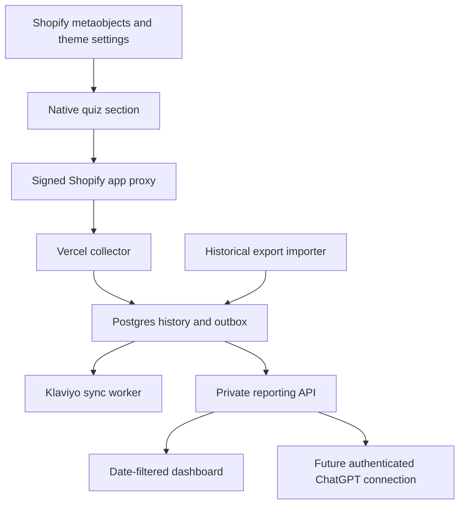

# Duradry Quiz Intelligence

Shopify-managed quiz content, a Vercel collection and Klaviyo sync service, and a private reporting dashboard. Version 0.3.0 — prepared October 18, 2026.

**Status:** source implemented and locally verified. Not deployed, not installed in Shopify, and not connected to a production database or Klaviyo write key. Existing flows and the live quiz are unchanged.

## What is included

- `shopify/`: native Liquid section, snippets, page template, and locale additions. All question text, options, buttons, result destinations, and rule conditions remain editable through Shopify metaobjects; presentation and connection settings live in the theme editor.
- `shopify-content/`: six metaobject definitions and 46 initial entries with an installer. Recommendation rules remain a reviewed draft based on the public flow, not an authoritative Octane configuration export.
- `api/collect.mjs`: signed Shopify app-proxy collection, server-side validation and recommendation resolution, durable sessions, and an idempotent outbox.
- `api/sync.mjs`: queued Klaviyo profile/event updates, bounded retries, and optional explicit marketing subscriptions.
- `public/`: responsive private reporting dashboard; date and timezone selectors, previous-period comparison, source filter, question answer distributions, data coverage, JSON export and print layout.
- `tools/`: history export/import, configuration snapshots, database migration, and an offline dashboard builder.
- `docs/REPORT-PROMPTS.md`: ready-to-use reporting prompts and instructions for connecting future scheduled reports.

## Architecture

## Setup sequence

1. Create a private source repository from this folder. Do not add the separate history archive or offline history dashboard to the repository or `public/`.
2. Create a Neon Postgres database and a Vercel project with this folder as root. Use Node 22 or newer. Install with `npm ci`; run `npm test` and `npm run build`.
3. Configure the variables listed in `.env.example` securely in Vercel and your local deployment environment. Never put credentials in Liquid, metaobjects, source control, report prompts, or chat messages. Use a 32-byte random base64 value for `CONTACT_ENCRYPTION_KEY`; use independent random secrets of at least 32 characters for application/API/cron keys and a strong dashboard password of at least 16 characters. Preserve the encryption key when redeploying; losing it prevents pending contacts from being synced.
4. Run `node tools/migrate.mjs` with `DATABASE_URL` in the environment. Import the prepared private history bundle with `node tools/import-history-bundle.mjs /PRIVATE/PATH/quiz-history`, then repeat with `--apply`. See `docs/HISTORY.md`.
5. Deploy this project. Set `APP_ORIGIN` to the exact HTTPS origin, without a trailing slash. Open the dashboard and sign in with `DASHBOARD_PASSWORD`. Vercel deployment protection must allow Shopify's collector and the cron request to reach their routes; their application-level authentication remains required.
6. Configure a store-installed Shopify app with an app proxy. For example, storefront `/apps/duradry-quiz` proxies to `https://YOUR-HOST/api/collect`. Set its client secret as `SHOPIFY_API_SECRET`, and `SHOPIFY_STORE=duradry-store.myshopify.com`. This package contains the proxy endpoint, not an OAuth installation UI; use an appropriate single-store app configuration. A Shopify access token alone is not the app's signing secret.
7. Install the metaobject definitions/entries with `shopify-content/tools/install-data.mjs` after reviewing its dry-run output and `docs/CONTENT.md`. Copy the theme additions into a duplicate theme; merge the locale keys instead of replacing the store's locale file. Set the quiz section to app-proxy mode and the storefront proxy path. Select the flow metaobject in the theme editor.
8. Publish the native quiz first at a preview/test page. Set `QUIZ_CONFIG_URL` to that full trusted Shopify URL. The backend reads its `data-dq-config` JSON and stores immutable content snapshots. If the page is not public yet, register a **matching rendered configuration** with `node tools/register-config.mjs CONFIG.json`. The bundled config is a draft, not a substitute for the merchant's final published config.
9. Configure a scoped Klaviyo private key for profile and event writes. Keep `KLAVIYO_SUBSCRIBE_OPT_INS=false` until the destination list and consent wording are reviewed. For subscriptions, also configure the list ID and subscription write scope. Existing consent is not inferred from quiz completion.
10. Review the Klaviyo flow migration in `docs/KLAVIYO.md`. Validate with a controlled profile and draft flow before activating any email flow. Switch the store's quiz page only after the exact Octane routes, result product availability, offer/gift behavior, mobile flow, and capture behavior have been accepted.

`vercel.json` configures the outbox worker once per minute **when this project is deployed**. No task has been scheduled in ChatGPT. Confirm the chosen Vercel plan supports the cron cadence and this commercial use. Hosting, database, and maintenance are separate costs; this is not a promise of zero operating cost. If cron is unavailable, call the authenticated sync endpoint from an approved scheduler.

## Day-to-day editing

Edit Shopify metaobjects and theme settings. **Increment the flow version for every question, option, rule, or result change.** The backend validates each submission against that version's stored configuration. Keep stable field/option keys when only changing wording. Previous submissions retain the answers and config version they used.

The seed rules produce three routines × two gift colors. They reproduce 4,441 supplied result rows; one other row uses Octane’s default result page. Confirm the fallback behavior and any unobserved hidden rules before replacing the live quiz.

## Boundaries

- The historical dashboard combines 13,303 Klaviyo events and 9,990 Octane CSV rows using exact result links. Its default all-history view contains 13,308 completions after matching and test exclusion. A separate fixed PDF snapshot preserves vendor-reported revenue and funnel metrics. See `docs/RECONCILIATION.md`.
- Answer distributions default to completed quizzes for comparability; a selector includes unfinished rows when desired. Native telemetry now records question duration and back clicks. CSV response counts remain distinct from views or proven abandonment.
- Native question telemetry is collected only when Shopify's analytics consent API permits it. The explicit completed submission still saves the answers/contact needed to fulfill the quiz. Therefore the funnel describes observed, consenting sessions, not necessarily all traffic.
- Contact information is encrypted separately from analytical answers. The dashboard API omits contact fields. Free-text answers can still contain personal information; keep the dashboard and archives private.
- The report selects sessions by their first observed event. Legacy completion-only records use completion time. See the definitions in every report when comparing sources.
- The collector records a consent-gated cart session attribute for possible order linking, but no Shopify order webhook/import is implemented. Revenue stays unavailable until a verified order integration populates `quiz_orders`; it must document attribution and refund treatment.
- There is no management UI for failed sync jobs, deletions, or key rotation. Operational SQL guidance is included in `docs/OPERATIONS.md`.
- The dashboard password protects the reporting data; static dashboard assets contain no production history. For a larger team, add individual access control before broad distribution.

## Verification

Local tests cover signed requests, payload tampering, encrypted contacts, retry deduplication, finalized submissions, history import conflicts, consent separation, historical coverage, and date boundaries including daylight saving time. Shopify Theme Check passed the five supplied theme files. Production delivery and email rendering still require a deployed staging test.
